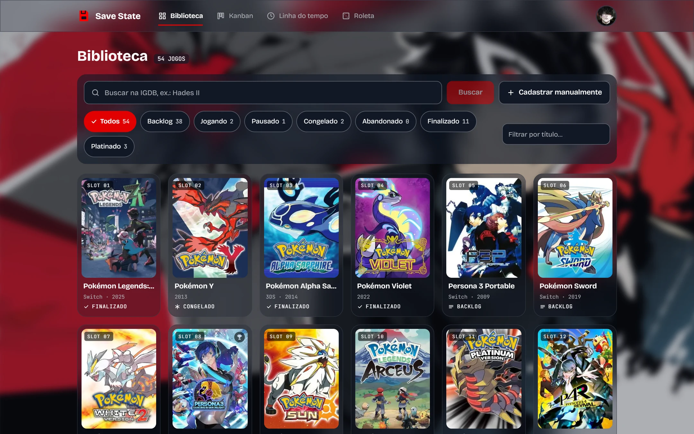
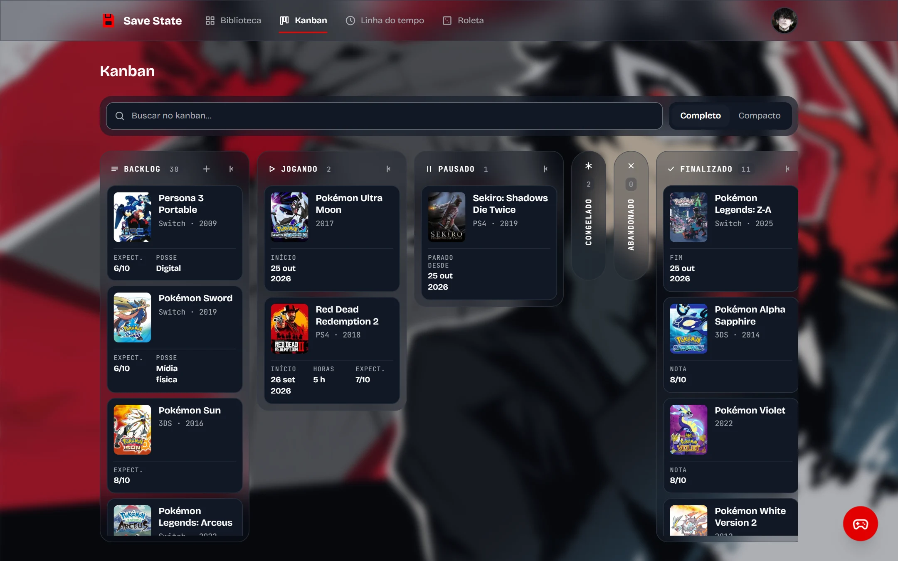
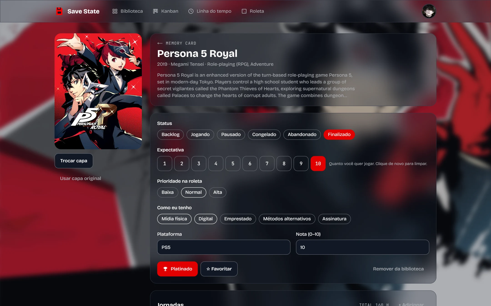
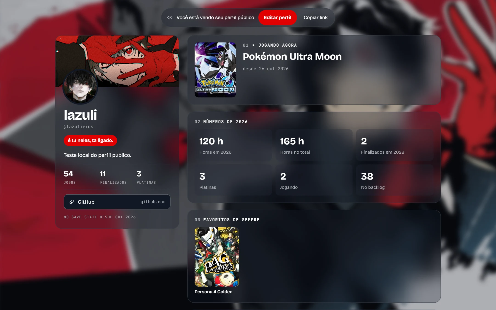
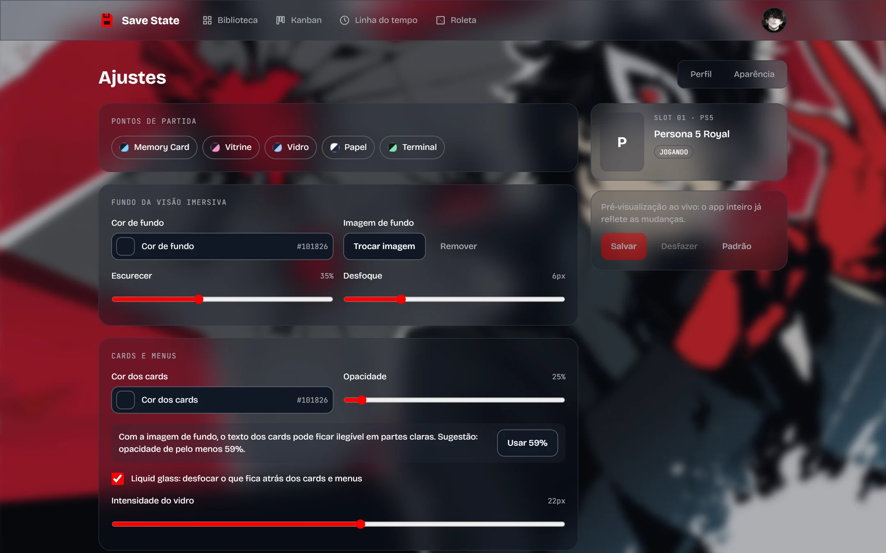
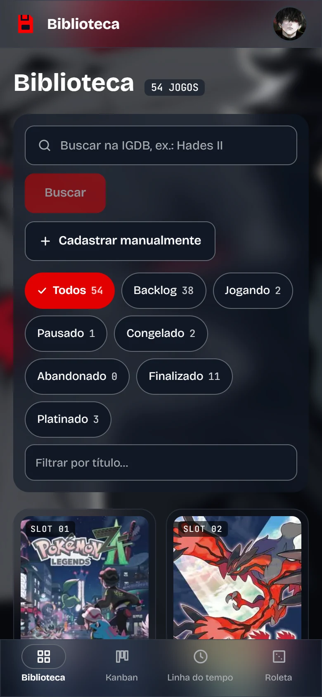
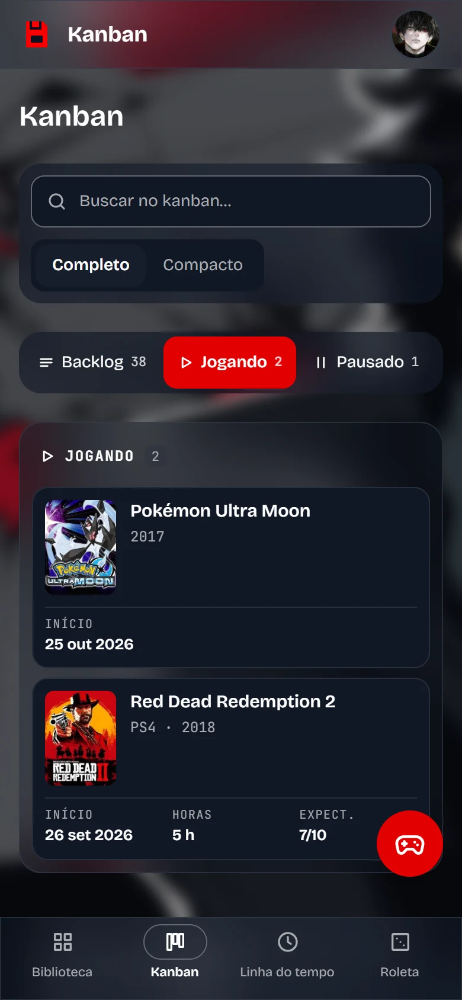
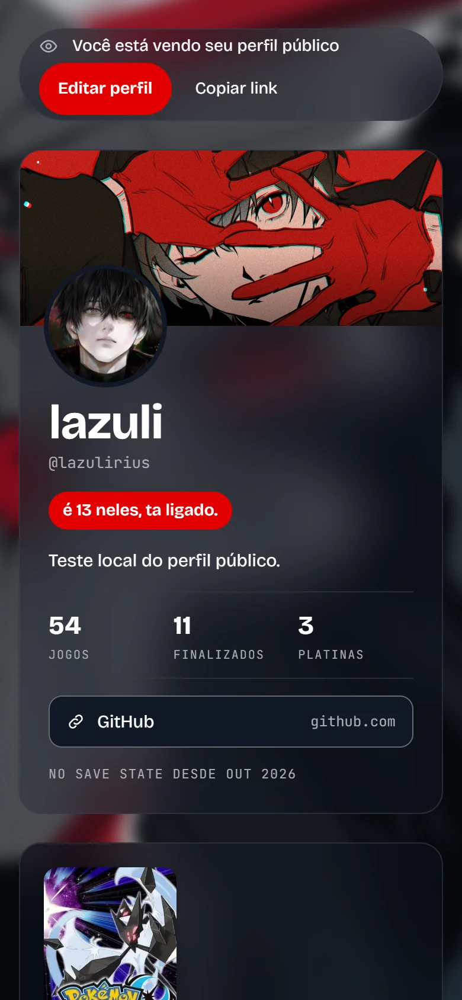

# Save State

**English** · [Português](README.pt-BR.md)

A personal game journal: your library, playthroughs, reviews, screenshots and a public profile that looks the way you want. Made for the phone as much as the desktop.



## Why

Tools like Backloggd and MyAnimeList are great for cataloguing, but they look the same for everyone and care more about the catalogue than your own history. Save State is the other way around: a private diary first, where each game keeps its playthroughs, hours, notes and memories, wrapped in a theme you set yourself.

## Features

- **Library** with IGDB search or manual entry (handy for physical NDS carts), vertical covers, status filters with counts and a platinum filter.
- **Statuses** that match how people actually play: Backlog, Playing, Paused, Shelved, Dropped and Finished, plus a platinum check and how you own it (physical, digital, borrowed, subscription or "alternative methods").
- **Kanban** with drag and drop (mouse, touch and keyboard), columns that collapse into pills, search inside the board and quick add from anywhere.
- **Playthroughs**: every run has its own dates (they can be just a month or a year when you don't remember the day) and hours, so you get totals for the year and all time. Changing a status opens or closes a playthrough on its own.
- **Journal**: a review per game plus dated entries, each one private or public, and screenshots with captions that can be linked to an entry.
- **Next-adventure roulette** weighted by each game's priority, drawing from as many statuses and platforms as you like.
- **Public profile** built from modules you can reorder and hide: now playing, yearly numbers, numbered favorites (drag to reorder), finished this year, recent reviews and a gallery.
- **Theme editor**: background color or image with dim and blur, card color and opacity, liquid glass, corner radius from square to round, accent color and font family. Text colors are computed from the background, and the color picker checks contrast before you save.
- **Custom covers** with cropping to the card's shape.
- **Finished gallery**: every completed game grouped by the year you finished it, with rating and hours.
- **Installable** on the phone's home screen, and you can delete your account and everything in it from the settings.

## Screenshots

|                                   Kanban                                    |                                     Game page                                     |
| :-------------------------------------------------------------------------: | :-------------------------------------------------------------------------------: |
|            |  |
|                             **Public profile**                              |                                  **Appearance**                                   |
|  |           |

<p align="center">
  
  
  
</p>

## Polishing for v1

What is left before the first public release:

- Production deploy on Vercel with a hosted Supabase project.
- A visual pass over every theme preset, Paper and Glass especially.

## Stack

Next.js 16 (App Router, Cache Components) · React 19 · TypeScript · Tailwind CSS 4 · Supabase (Postgres with RLS, Auth, Storage) · IGDB · dnd-kit · Zod · Vitest · GitHub Actions · Docker

## Getting started

You need Node 24 (`.nvmrc`) and Docker if you want the database running locally.

```bash
npm install
cp .env.example .env.local
```

Fill in `.env.local`:

| Variable                                                                                  | Where to get it                                                                           |
| ----------------------------------------------------------------------------------------- | ----------------------------------------------------------------------------------------- |
| `NEXT_PUBLIC_SUPABASE_URL`, `NEXT_PUBLIC_SUPABASE_PUBLISHABLE_KEY`, `SUPABASE_SECRET_KEY` | Supabase → Project Settings → API Keys, or the output of `npm run db:start`               |
| `IGDB_CLIENT_ID`, `IGDB_CLIENT_SECRET`                                                    | Create an application at [dev.twitch.tv/console/apps](https://dev.twitch.tv/console/apps) |

IGDB is optional: without the keys, search is turned off but manual entry still works.

### Database

Local, with Docker (Studio at [127.0.0.1:54323](http://127.0.0.1:54323), sign-in e-mails at [127.0.0.1:54324](http://127.0.0.1:54324)):

```bash
npm run db:start
```

Or a hosted Supabase project:

```bash
npx supabase login
npx supabase link --project-ref <project-ref>
npm run db:push
```

### Development

```bash
npm run dev
```

Open [localhost:3000](http://localhost:3000). In Supabase, add `http://localhost:3000/auth/callback` (and your production URL) under Authentication → URL Configuration → Redirect URLs.

## Scripts

| Script                                | What it does                                                   |
| ------------------------------------- | -------------------------------------------------------------- |
| `dev` / `build` / `start`             | Next.js                                                        |
| `lint`, `typecheck`, `test`, `format` | Code quality                                                   |
| `check`                               | Lint, typecheck and tests                                      |
| `db:start` / `db:stop` / `db:reset`   | Local Supabase                                                 |
| `db:migration <name>`                 | New migration                                                  |
| `db:push`                             | Apply migrations to the linked project                         |
| `db:types`                            | Generate database types into `src/types/database.generated.ts` |
| `docker:up` / `docker:down`           | Start or stop the app container                                |

## Deploy

### Vercel

1. Import the GitHub repository on Vercel.
2. Add the variables from `.env.example` under Settings → Environment Variables, with `NEXT_PUBLIC_SITE_URL` set to the production domain.

### Docker

The same code builds a standalone image (`Dockerfile`), useful at home or on a VPS:

```bash
npm run docker:up
```

`NEXT_PUBLIC_*` variables are baked in at build time; the rest are read from `.env.local` at runtime. With local Supabase, set `DOCKER_SUPABASE_URL=http://host.docker.internal:54321` so the server inside the container can reach the database while the browser keeps using `127.0.0.1`.

## License

[PolyForm Noncommercial 1.0.0](LICENSE). You can use, study and modify it for noncommercial purposes, as long as you keep the required notices and credit the author. For a commercial license, use the form linked in the `LICENSE`.

Game data provided by [IGDB](https://www.igdb.com). Save State is a personal project with no affiliation with Sony, Nintendo, Microsoft, Valve, IGDB, Twitch or any publisher. Names, covers and trademarks belong to their owners.

Made by [Nathã Grazzioli (localhost-ayu)](https://github.com/localhost-ayu) · natha@grazzioli.dev
