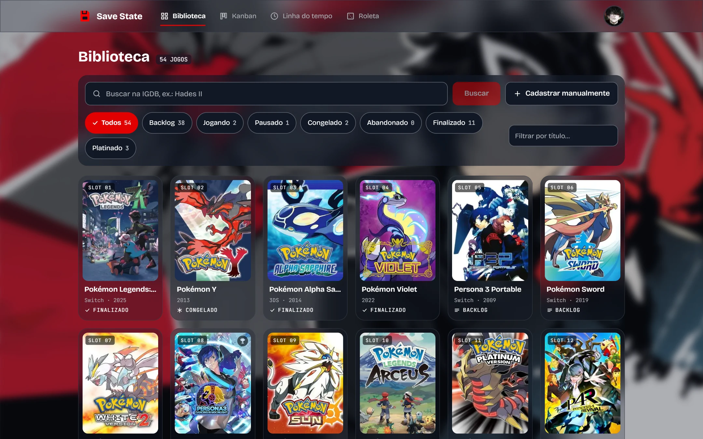
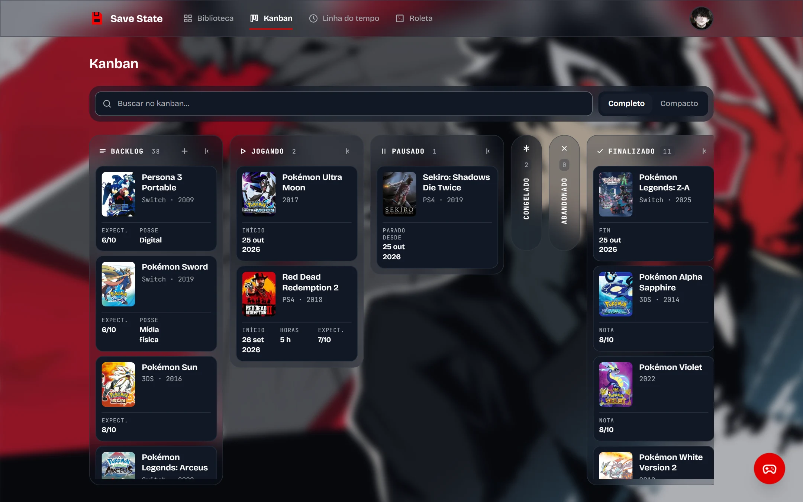
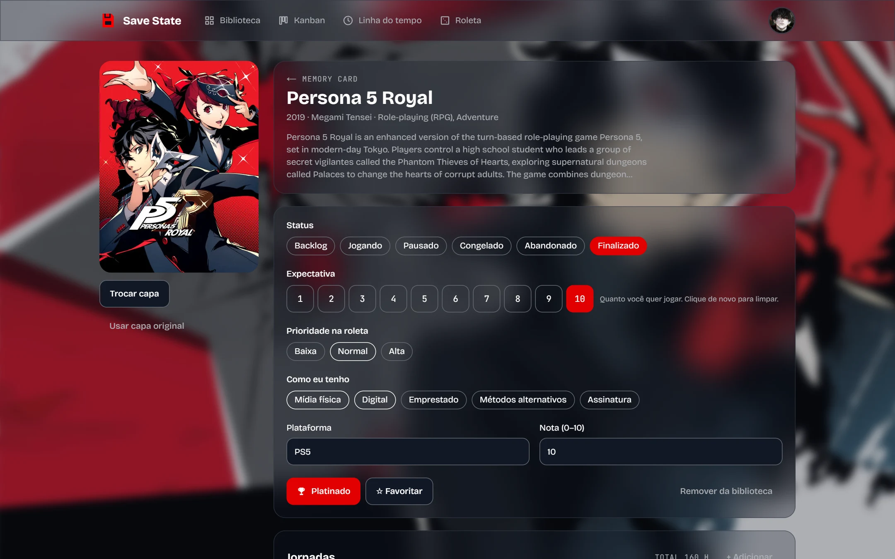
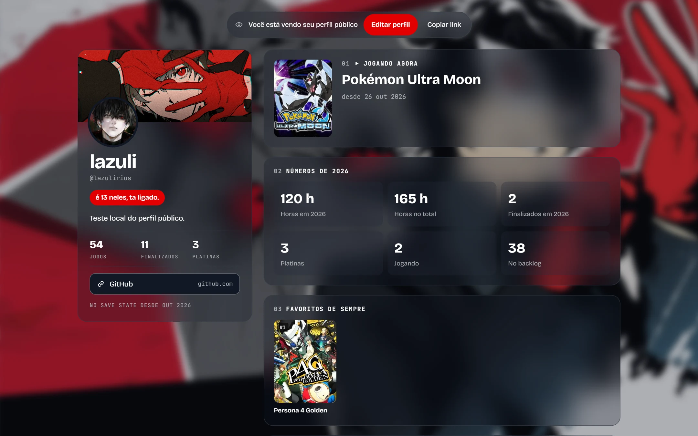
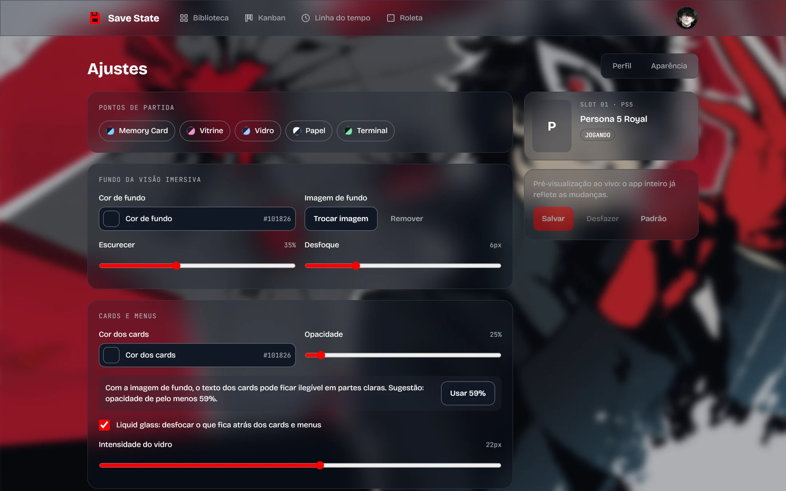
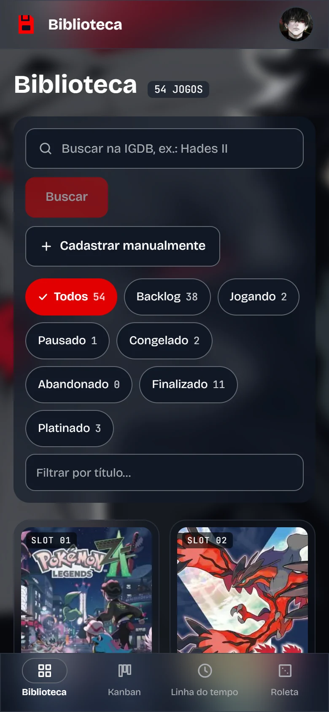
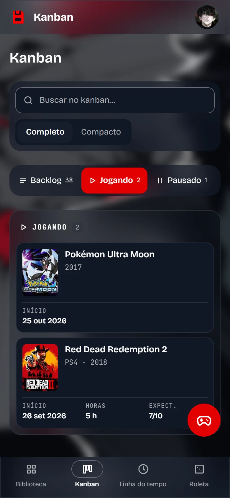
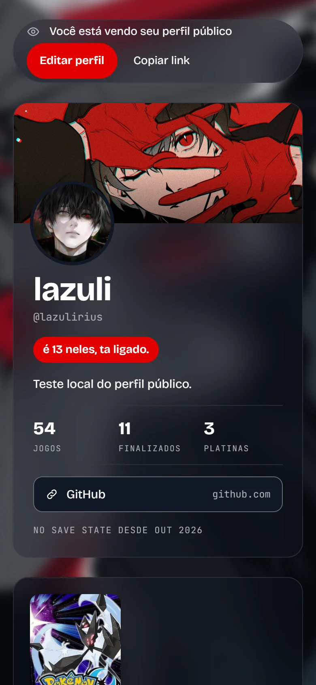

# Save State

[English](README.md) · **Português**

Um diário pessoal de jogos: sua biblioteca, jornadas, reviews, screenshots e um perfil público com a sua cara. Feito para o celular tanto quanto para o computador.



## Por quê

Backloggd e MyAnimeList são ótimos para catalogar, mas são iguais para todo mundo e pensam mais no catálogo do que na sua história. O Save State inverte isso: primeiro um diário pessoal, em que cada jogo guarda suas jornadas, horas, notas e memórias, dentro de um tema que você mesmo monta.

## Funcionalidades

- **Biblioteca** com busca no IGDB ou cadastro manual (ótimo para cartuchos de NDS), capas verticais, filtros por status com contagem e filtro de platinados.
- **Status** que refletem como a gente joga de verdade: Backlog, Jogando, Pausado, Congelado, Abandonado e Finalizado, mais a marcação de platina e como você tem o jogo (mídia física, digital, emprestado, assinatura ou "métodos alternativos").
- **Kanban** com arrastar e soltar (mouse, toque e teclado), colunas que viram pílulas, busca dentro do quadro e adição rápida de qualquer lugar.
- **Jornadas**: cada vez que você joga tem datas próprias (pode ser só o mês ou o ano, quando você não lembra o dia) e horas, com totais do ano e de sempre. Mudar o status abre ou fecha a jornada sozinho.
- **Diário**: review por jogo e registros com data, cada um privado ou público, e screenshots com legenda que podem ser ligadas a um registro.
- **Roleta da próxima aventura**, ponderada pela prioridade de cada jogo, sorteando entre quantos status e plataformas você quiser.
- **Perfil público** montado com módulos que você reordena e esconde: jogando agora, números do ano, favoritos numerados (arraste para reordenar), finalizados do ano, reviews recentes e galeria.
- **Editor de tema**: cor ou imagem de fundo com escurecimento e desfoque, cor e opacidade dos cards, liquid glass, cantos de retos a arredondados, cor de destaque e tipografia. As cores de texto são calculadas a partir do fundo, e o seletor de cor confere o contraste antes de salvar.
- **Capas personalizadas** com recorte no formato do card.
- **Galeria de finalizados**: todos os jogos zerados, agrupados pelo ano em que você terminou, com nota e horas.
- **Instalável** na tela inicial do celular, e você pode excluir sua conta e tudo o que há nela pelos ajustes.

## Prints

|                                  Kanban                                  |                                    Página do jogo                                     |
| :----------------------------------------------------------------------: | :-----------------------------------------------------------------------------------: |
|        |  |
|                            **Perfil público**                            |                                     **Aparência**                                     |
|  |    |

<p align="center">
  
  
  
</p>

## Refinos para a v1

O que falta antes da primeira versão pública:

- Deploy de produção na Vercel com um projeto Supabase hospedado.
- Revisão visual de todos os temas prontos, Papel e Vidro principalmente.

## Stack

Next.js 16 (App Router, Cache Components) · React 19 · TypeScript · Tailwind CSS 4 · Supabase (Postgres com RLS, Auth, Storage) · IGDB · dnd-kit · Zod · Vitest · GitHub Actions · Docker

## Começando

Você precisa do Node 24 (`.nvmrc`) e do Docker, se quiser o banco rodando localmente.

```bash
npm install
cp .env.example .env.local
```

Preencha o `.env.local`:

| Variável                                                                                  | Onde obter                                                                             |
| ----------------------------------------------------------------------------------------- | -------------------------------------------------------------------------------------- |
| `NEXT_PUBLIC_SUPABASE_URL`, `NEXT_PUBLIC_SUPABASE_PUBLISHABLE_KEY`, `SUPABASE_SECRET_KEY` | Supabase → Project Settings → API Keys, ou a saída de `npm run db:start`               |
| `IGDB_CLIENT_ID`, `IGDB_CLIENT_SECRET`                                                    | Crie uma aplicação em [dev.twitch.tv/console/apps](https://dev.twitch.tv/console/apps) |

O IGDB é opcional: sem as chaves, a busca fica desligada, mas o cadastro manual funciona.

### Banco

Local, com Docker (Studio em [127.0.0.1:54323](http://127.0.0.1:54323), e-mails de login em [127.0.0.1:54324](http://127.0.0.1:54324)):

```bash
npm run db:start
```

Ou um projeto Supabase hospedado:

```bash
npx supabase login
npx supabase link --project-ref <project-ref>
npm run db:push
```

### Desenvolvimento

```bash
npm run dev
```

Abra [localhost:3000](http://localhost:3000). No Supabase, adicione `http://localhost:3000/auth/callback` (e a URL de produção) em Authentication → URL Configuration → Redirect URLs.

## Scripts

| Script                                | O que faz                                                   |
| ------------------------------------- | ----------------------------------------------------------- |
| `dev` / `build` / `start`             | Next.js                                                     |
| `lint`, `typecheck`, `test`, `format` | Qualidade de código                                         |
| `check`                               | Lint, typecheck e testes                                    |
| `db:start` / `db:stop` / `db:reset`   | Supabase local                                              |
| `db:migration <nome>`                 | Nova migration                                              |
| `db:push`                             | Aplica as migrations no projeto vinculado                   |
| `db:types`                            | Gera os tipos do banco em `src/types/database.generated.ts` |
| `docker:up` / `docker:down`           | Sobe ou derruba o container do app                          |

## Deploy

### Vercel

1. Importe o repositório do GitHub na Vercel.
2. Adicione as variáveis do `.env.example` em Settings → Environment Variables, com `NEXT_PUBLIC_SITE_URL` apontando para o domínio de produção.

### Docker

O mesmo código gera uma imagem standalone (`Dockerfile`), útil para rodar em casa ou numa VPS:

```bash
npm run docker:up
```

As variáveis `NEXT_PUBLIC_*` entram no build da imagem; as demais são lidas do `.env.local` em tempo de execução. Com o Supabase local, defina `DOCKER_SUPABASE_URL=http://host.docker.internal:54321` para o servidor dentro do container alcançar o banco, enquanto o navegador continua usando `127.0.0.1`.

## Licença

[PolyForm Noncommercial 1.0.0](LICENSE). Você pode usar, estudar e modificar para fins não comerciais, mantendo os avisos obrigatórios e o crédito ao autor. Para uma licença comercial, use o formulário indicado no `LICENSE`.

Dados de jogos fornecidos pelo [IGDB](https://www.igdb.com). O Save State é um projeto pessoal, sem afiliação com Sony, Nintendo, Microsoft, Valve, IGDB, Twitch ou qualquer publisher. Nomes, capas e marcas pertencem aos respectivos donos.

Feito por [Nathã Grazzioli (localhost-ayu)](https://github.com/localhost-ayu) · natha@grazzioli.dev
